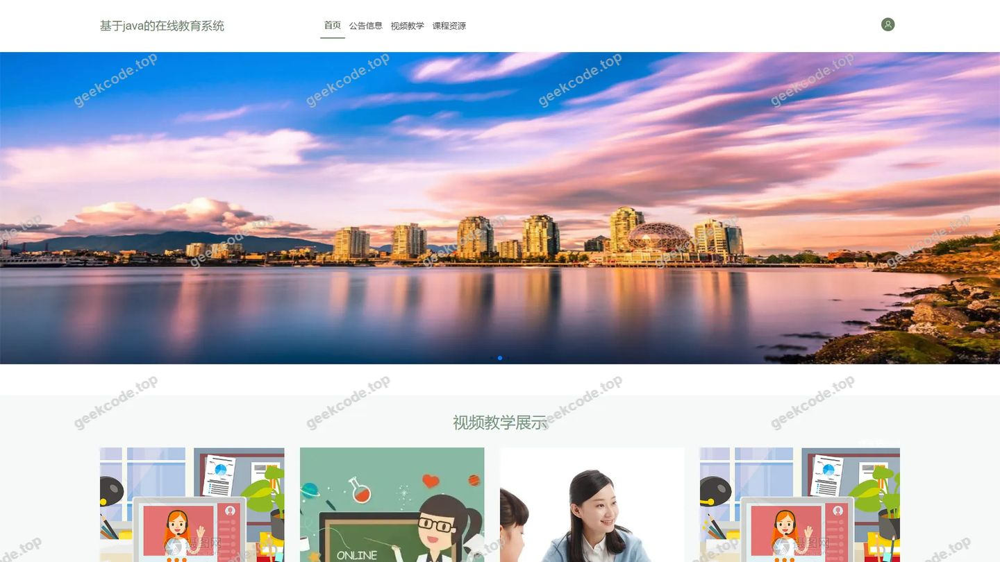
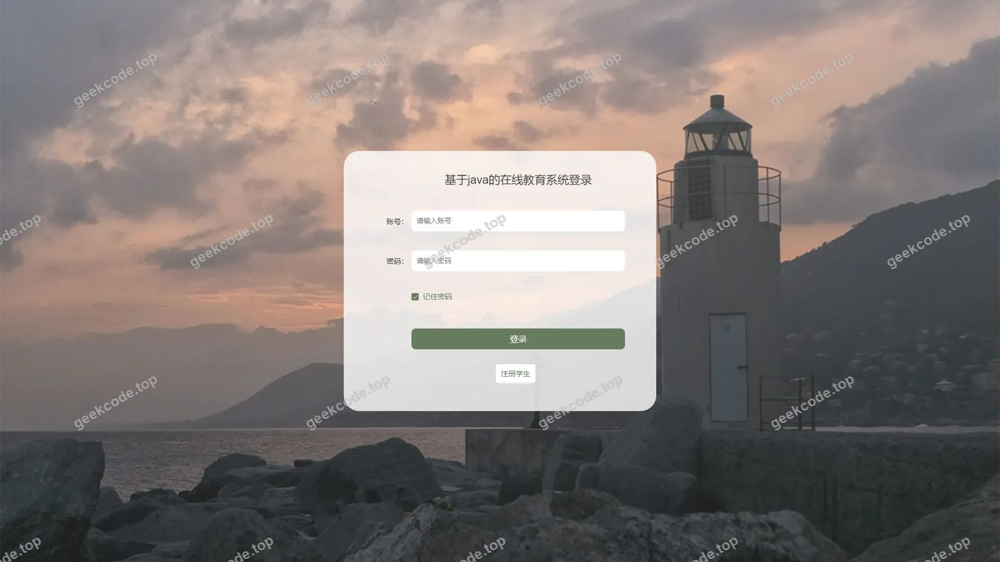
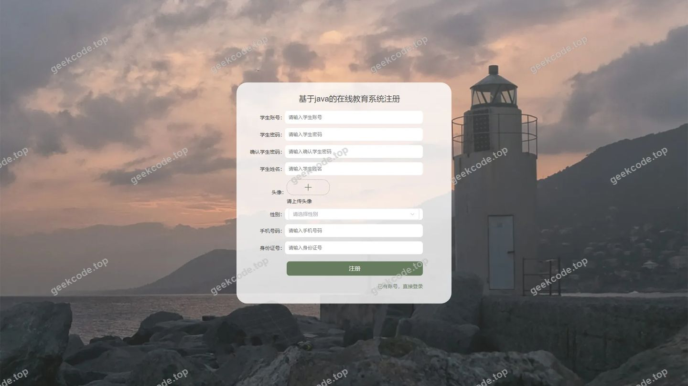
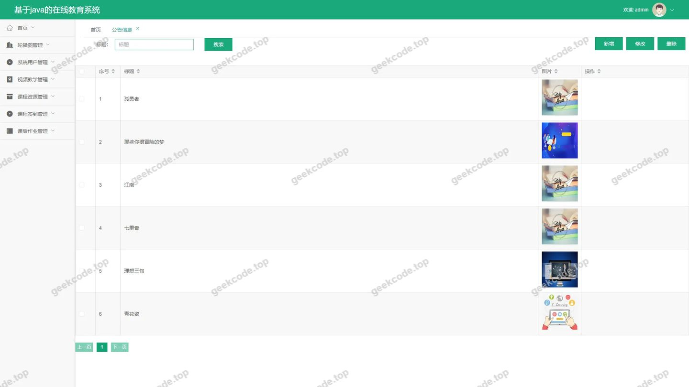
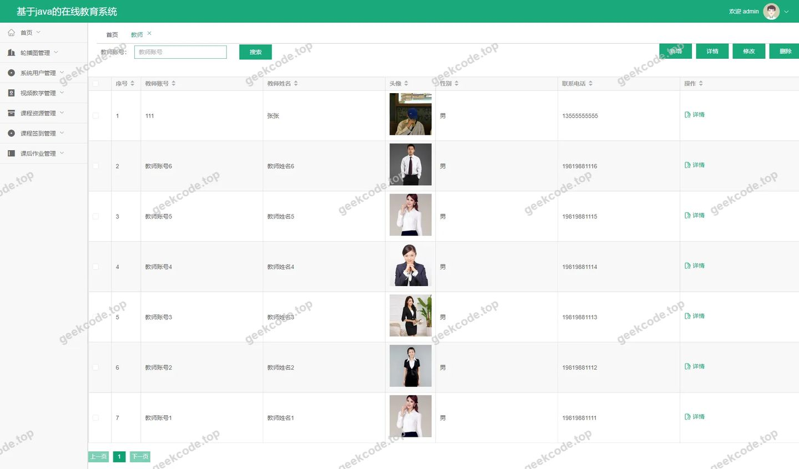
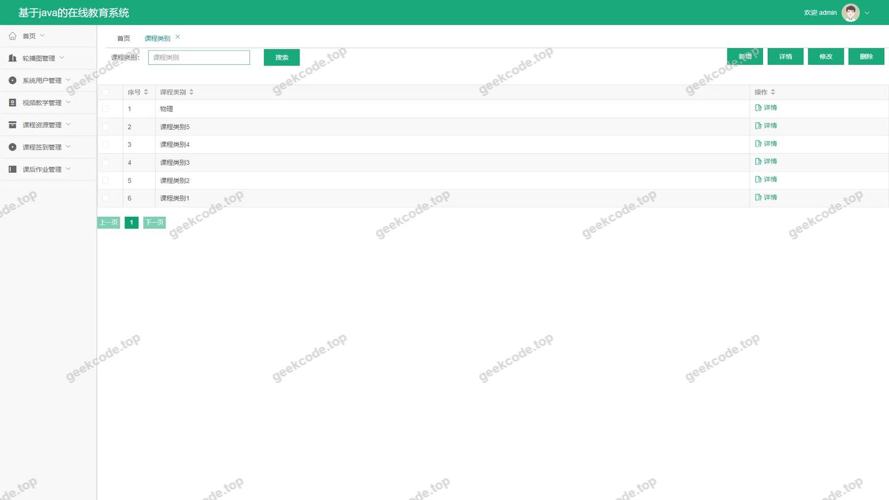
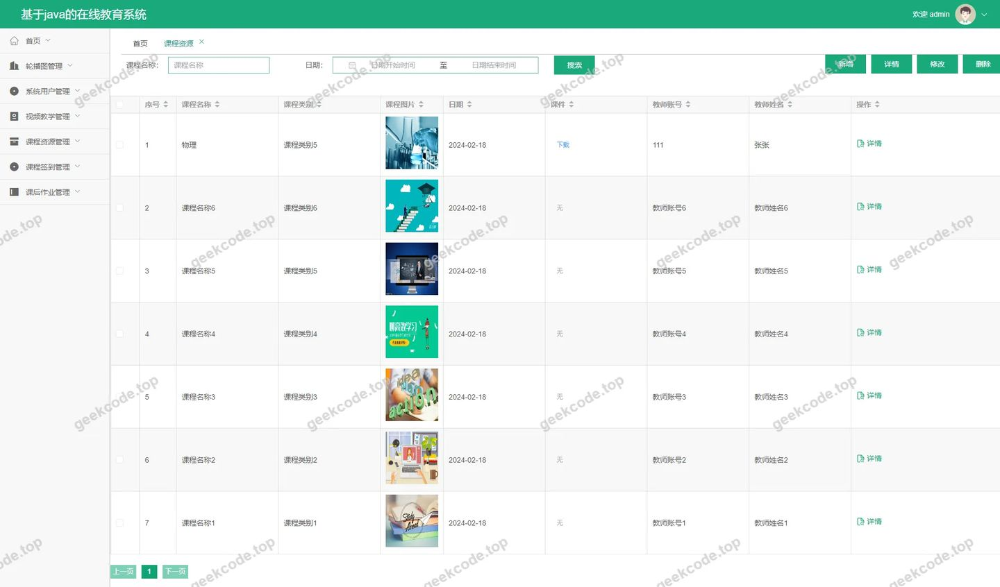
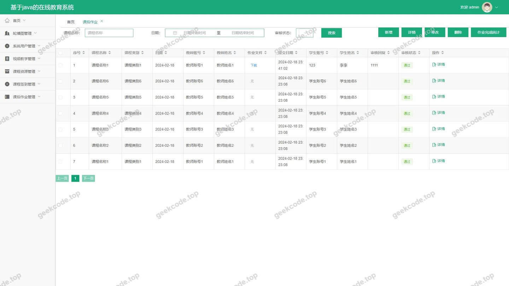
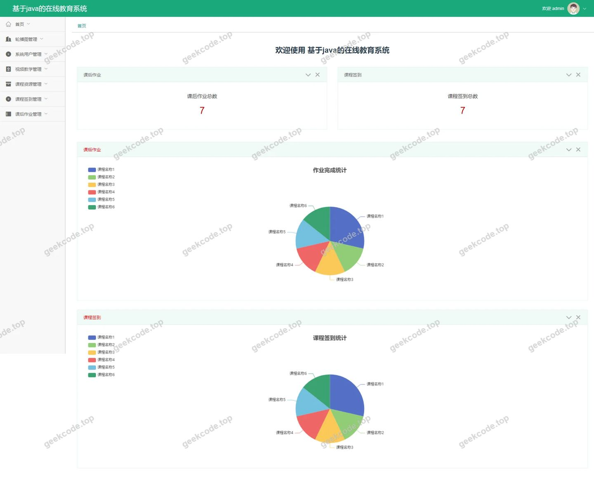
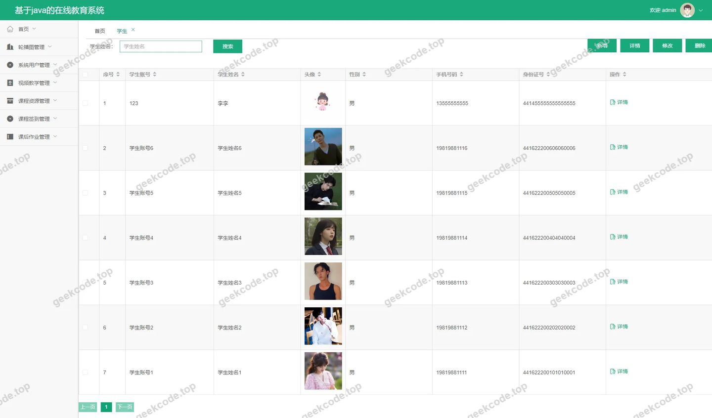

# 基于java的在线教育系统

> 🎓 **计算机毕业设计 · 基于java的在线教育系统**
>
> 本仓库只放**项目介绍 + 运行截图**（截图是站点带水印的原图，存在仓库 `images/` 里）。
>
> 👉 **完整可运行源码 / 数据库脚本 / 部署文档：[点我获取](https://geekcode.top/archives/%E5%9F%BA%E4%BA%8Ejava%E7%9A%84%E5%9C%A8%E7%BA%BF%E6%95%99%E8%82%B2%E7%B3%BB%E7%BB%9F?utm_source=github)**
>
> 💬 咨询微信：**ir9372**　|　🌐 更多项目：[极客代码 geekcode.top](https://geekcode.top/?utm_source=github)
>
> 📌 项目详情页：<https://geekcode.top/archives/%E5%9F%BA%E4%BA%8Ejava%E7%9A%84%E5%9C%A8%E7%BA%BF%E6%95%99%E8%82%B2%E7%B3%BB%E7%BB%9F?utm_source=github>

<table><td width="230" align="center"> <b>扫码加微信 ir9372</b></td><td valign="middle">📦 源码 = 项目介绍 + 全部运行截图 + 数据库 + 部署文档 👉 点上方任意截图，直接跳到 <b>极客代码 geekcode.top</b> 详情页</td></table>

---

<h1>基于java的在线教育系统</h1>
<h2>项目概述</h2>

本项目为基于 Java 的在线教育系统，旨在构建一个集教学管理、课程资源分发及师生互动于一体的综合性平台。系统采用前后端分离架构，后端基于 Spring Boot 框架，前端集成 Vue 技术栈，通过 MyBatis-Plus 进行数据持久化操作，并利用 Shiro 实现权限控制。核心功能涵盖学生注册登录、教师信息管理、课程类别与资源维护、课后作业发布以及视频教学模块。适用人群包括学校教务管理员、授课教师及在校学生。该系统解决了传统线下教育中资源分散、考勤困难及作业反馈滞后等问题，实现了教育资源的数字化管理与高效流转。

<h2>技术架构</h2>
<h3>总体架构</h3>

系统采用典型的 B/S 架构，分为表现层、业务逻辑层和数据访问层。

<ul>
<li><strong>表现层</strong>：使用 Vue.js 构建单页面应用（SPA），提供前台用户界面和后台管理界面。</li>
<li><strong>业务逻辑层</strong>：基于 Spring Boot 框架构建 RESTful API，处理核心业务逻辑，如用户认证、数据校验及服务调度。</li>
<li><strong>数据访问层</strong>：利用 MyBatis-Plus 简化 CRUD 操作，通过 MySQL Connector/J 驱动连接 MySQL 数据库。</li>
<li><strong>安全架构</strong>：引入 Apache Shiro 框架实现身份认证与授权，确保不同角色对用户数据和系统功能的访问符合安全规范。</li>
</ul>
<h3>核心技术选型理由</h3>
<ol>
<li><strong>Spring Boot</strong>：提供快速开发能力，自动配置机制减少了繁琐的 XML 配置，内置 Tomcat 容器便于部署。</li>
<li><strong>MyBatis-Plus</strong>：在 MyBatis 基础上增强，提供了通用的 CRUD 接口和条件构造器，显著提升开发效率并减少样板代码。</li>
<li><strong>Shiro</strong>：轻量级且功能强大的安全框架，相比 Spring Security 更易于上手，适合中小型项目的权限管理需求。</li>
<li><strong>Vue-integrated</strong>：结合 Vue 生态，实现组件化开发，提升前端页面的响应速度和用户体验。</li>
</ol>
<h3>数据库设计要点</h3>

数据库主要围绕“人”、“课”、“资”三大实体进行设计。包含用户表（区分管理员、教师、学生）、课程类别表、课程资源表、课后作业表及签到记录表。各表之间通过外键关联，例如课程资源需关联特定的课程类别和教师ID，确保数据的一致性和完整性。

<h2>功能模块</h2>

根据路由配置及截图信息，系统功能划分为前台用户端和后台管理端两大板块。

<h3>前台用户端功能</h3>

前台主要面向学生和教师，提供基础的信息浏览与交互服务。

<ul>
<li><strong>首页展示</strong>：展示系统概览及最新公告或推荐内容。</li>
<li><strong>用户认证</strong>：</li>
<li><strong>学生注册/登录</strong>：提供学生账号的创建入口及身份验证功能。</li>
<li><strong>教师注册/登录</strong>：支持教师账号的申请与系统接入。</li>
<li><strong>个人中心</strong>：</li>
<li><strong>学生中心</strong>：查看个人信息及相关学习记录。</li>
<li><strong>教师中心</strong>：查看个人授课信息及资料管理入口。</li>
<li><strong>信息查询与管理</strong>：</li>
<li><strong>学生管理</strong>：列表查看、详情浏览及新增录入（视权限而定）。</li>
<li><strong>教师管理</strong>：列表查看、详情浏览及新增录入。</li>
<li><strong>课程类别</strong>：浏览课程分类体系，查看详情及添加新类别。</li>
<li><strong>课程资源</strong>：查看各类教学资源文件，支持详情预览及上传。</li>
<li><strong>课后作业</strong>：查看作业列表、题目详情及提交/添加作业。</li>
<li><strong>视频教学</strong>：观看教学视频列表及具体视频详情页。</li>
<li><strong>课程签到</strong>：查看签到记录列表及详情，支持新增签到。</li>
<li><strong>新闻公告</strong>：浏览系统发布的新闻列表。</li>
</ul>
<h3>后台管理端功能</h3>

后台主要面向系统管理员，提供全面的数据维护与配置能力。

<ul>
<li><strong>系统登录</strong>：管理员身份验证入口。</li>
<li><strong>首页仪表盘</strong>：展示关键数据统计及快捷操作入口。</li>
<li><strong>基础信息管理</strong>：</li>
<li><strong>用户管理</strong>：对系统所有注册用户进行增删改查。</li>
<li><strong>教师管理</strong>：审核教师资质，维护教师档案信息。</li>
<li><strong>学生管理</strong>：维护学生学籍信息，支持批量导入或单独编辑。</li>
<li><strong>教师注册审核</strong>：处理教师提交的注册申请。</li>
<li><strong>教学资源管理</strong>：</li>
<li><strong>课程类别管理</strong>：定义和维护课程的分类标签。</li>
<li><strong>课程资源管理</strong>：上传、编辑、删除课件、文档等教学资源。</li>
<li><strong>视频教学管理</strong>：维护视频链接、标题及简介等信息。</li>
<li><strong>课后作业管理</strong>：发布作业任务，设置截止时间及评分标准。</li>
<li><strong>课程签到管理</strong>：监控学生出勤情况，管理签到规则。</li>
<li><strong>内容运营</strong>：</li>
<li><strong>新闻公告管理</strong>：发布和管理系统内的通知公告。</li>
<li><strong>系统配置</strong>：</li>
<li><strong>参数配置</strong>：修改系统全局参数，如站点名称、Logo、联系方式等。</li>
</ul>
<h2>用户角色与权限</h2>

系统依据 Shiro 框架定义了多层级的用户角色，不同角色拥有严格隔离的功能权限。

<table>
<thead>
<tr>
<th align="left">角色</th>
<th align="left">描述</th>
<th align="left">可访问的具体功能模块</th>
</tr>
</thead>
<tbody><tr>
<td align="left"><strong>超级管理员</strong></td>
<td align="left">系统最高权限持有者，负责整体运维</td>
<td align="left"><strong>后台全部功能</strong>：1. <code>/users</code> (用户管理)2. <code>/jiaoshi</code> (教师管理)3. <code>/xuesheng</code> (学生管理)4. <code>/kechengleibie</code> (课程类别)5. <code>/kechengziyuan</code> (课程资源)6. <code>/shipinjiaoxue</code> (视频教学)7. <code>/kehouzuoye</code> (课后作业)8. <code>/kechengqiandao</code> (课程签到)9. <code>/news</code> (新闻公告)10. <code>/config</code> (系统配置)11. <code>/jiaoshiRegister</code> (教师注册审核)</td>
</tr>
<tr>
<td align="left"><strong>教师</strong></td>
<td align="left">授课人员，负责教学内容维护</td>
<td align="left"><strong>前台部分功能 + 后台特定入口</strong>：1. <code>/jiaoshiCenter</code> (教师中心，可能用于查看个人状态)2. 前台路由中的 <code>/index/jiaoshiAdd</code>, <code>/index/kechengziyuanAdd</code>, <code>/index/kehouzuoyeAdd</code>, <code>/index/shipinjiaoxueAdd</code> (具备添加资源、作业和视频的能力)3. 查看自身相关的学生列表 (<code>/index/xueshengList</code>) 及签到记录</td>
</tr>
<tr>
<td align="left"><strong>学生</strong></td>
<td align="left">学习者，主要进行资源获取与任务提交</td>
<td align="left"><strong>前台受限功能</strong>：1. <code>/index/xueshengCenter</code> (学生中心)2. 浏览类：<code>/index/newsList</code>, <code>/index/kechengleibieList</code>, <code>/index/kechengziyuanList</code>, <code>/index/shipinjiaoxueList</code>, <code>/index/kehouzuoyeList</code>3. 操作类：<code>/index/kechengqiandaoAdd</code> (发起签到), <code>/index/kehouzuoyeDetail</code> (查看作业详情并提交)4. 注册类：<code>/xueshengRegister</code></td>
</tr>
</tbody></table>

<em>注：具体的前台菜单可见性取决于后端返回的角色标识，上述列表基于路由命名及常规教育系统设计推导其核心职责边界。</em>

<h2>项目特色与创新点</h2>
<ol>
<li><strong>全流程数字化闭环</strong>：从学生注册、选课浏览、视频学习、在线签到到课后作业提交，覆盖了在线教育的完整生命周期，数据链路清晰。</li>
<li><strong>模块化资源管理体系</strong>：将“课程类别”、“课程资源”与“视频教学”解耦又关联，支持多维度的教学资源检索与分类展示，提升了资源复用率。</li>
<li><strong>精细化权限控制</strong>：利用 Shiro 实现了细粒度的 RBAC（基于角色的访问控制），确保了教师与学生数据隐私的安全，同时赋予管理员灵活的系统配置能力。</li>
<li><strong>前后端分离的高效协作</strong>：Vue 前端与 Spring Boot 后端的分离架构，使得界面渲染与业务逻辑独立演进，提高了系统的可维护性与扩展性。</li>
</ol>
<h2>部署环境</h2>

为确保系统正常运行，需准备以下软件环境：

<ol>
<li><strong>Java 运行环境</strong>：</li>
</ol>
<ul>
<li>JDK 版本：建议 JDK 1.8 或更高版本（兼容 Spring Boot 2.x/3.x）。</li>
</ul>
<ol start="2">
<li><strong>数据库服务</strong>：</li>
</ol>
<ul>
<li>MySQL 数据库：版本 5.7 或 8.0+。</li>
<li>需执行初始化 SQL 脚本以创建表结构及初始数据。</li>
</ul>
<ol start="3">
<li><strong>Web 服务器</strong>：</li>
</ol>
<ul>
<li>内置 Tomcat（由 Spring Boot 自动启动）或独立安装 Nginx/Apache 作为反向代理。</li>
</ul>
<ol start="4">
<li><strong>前端构建环境</strong>：</li>
</ol>
<ul>
<li>Node.js：版本 LTS（长期支持版），用于编译打包 Vue 项目。</li>
<li>npm/yarn/pnpm：包管理器，用于安装前端依赖。</li>
</ul>
<ol start="5">
<li><strong>其他依赖</strong>：</li>
</ol>
<ul>
<li>Maven：用于管理 Java 后端项目的依赖库及构建打包。</li>
</ul>
<h2>五、技术特性</h2>
<ul>
<li>前后端集成部署，前端资源打包至后端 static 目录</li>
<li>使用 MyBatis-Plus 简化数据访问层开发</li>
<li>集成 Shiro 权限框架实现角色权限控制</li>
</ul>
<h2>六、功能模块截图</h2>
<h3>前台用户端</h3>
<h4>前台-首页</h4>

<h4>前台-登录</h4>

<h4>前台-学生注册</h4>

<h3>后台管理端</h3>
<h4>后台-登录页</h4>

<h4>后台-公告信息</h4>

<h4>后台-教师</h4>

<h4>后台-课程类别</h4>

<h4>后台-课程资源</h4>

<h4>后台-课后作业</h4>

<h4>后台首页</h4>

<h4>后台-学生</h4>

---

## 获取完整源码

| 项目 | 说明 |
| --- | --- |
| 项目名 | 基于java的在线教育系统 |
| 运行截图 | 本文 11 张（站点带水印原图，仓库 `images/` 目录） |
| 完整源码 | [https://geekcode.top/archives/%E5%9F%BA%E4%BA%8Ejava%E7%9A%84%E5%9C%A8%E7%BA%BF%E6%95%99%E8%82%B2%E7%B3%BB%E7%BB%9F?utm_source=github](https://geekcode.top/archives/%E5%9F%BA%E4%BA%8Ejava%E7%9A%84%E5%9C%A8%E7%BA%BF%E6%95%99%E8%82%B2%E7%B3%BB%E7%BB%9F?utm_source=github) |
| 咨询微信 | **ir9372**（备注：jingpin-yuanma） |
| 更多项目 | [极客代码 geekcode.top](https://geekcode.top/?utm_source=github) |

> 需要源码、部署、改配置、跑不起来等问题，加微信 ir9372 沟通，说明项目名即可。
